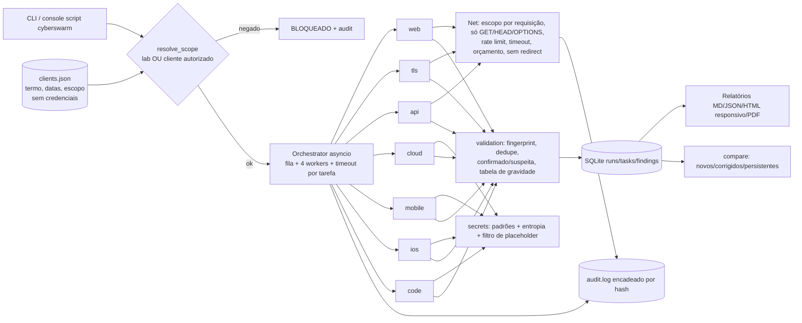

# CyberSwarm — Arquitetura (v0.3)



## Estrutura
```
cyberswarm/
  pyproject.toml  README.md  clients.example.json
  cyberswarm/
    cli.py orchestrator.py registry.py checks.py scope.py net.py audit.py db.py report.py lab.py log.py
    agents/ web.py tls.py api.py cloud.py code.py secrets.py mobile.py ios.py validation.py common.py
    labdata/ openapi.json terraform/ android/ ios/ src/     (laboratório: dados falsos)
  tests/  docs/ (ARCHITECTURE, SEVERIDADE, PRODUTO, COMMERCIAL)
```

## Decisões técnicas
| Tema | Escolha | Por quê |
|---|---|---|
| Orquestração | asyncio puro (stdlib) | Determinístico, testável, roda no Termux. LangGraph, CrewAI e AutoGen dependem de LLM e não ajudam em checagens que precisam ser reproduzíveis. |
| Plugins | classe `Agent` + `@register` | Novo auditor = 1 arquivo + checagens em `checks.py` |
| Gravidade | catálogo central `checks.py` | Uma única fonte de verdade, testada e documentada (SEVERIDADE.md) |
| TLS | `ssl` stdlib + `cryptography` (opcional) | Testa TLS 1.0/1.1 de verdade (SECLEVEL=0) e lê SAN e validade |
| PDF | fpdf2 (puro Python, pequeno) | weasyprint precisa de libs nativas (pango) e reportlab é maior; o fallback é o Chrome headless `--print-to-pdf` |
| Print do celular | Playwright + Chrome do sistema | O Chrome CLI `--screenshot` travou nesta máquina. O Playwright também mede a rolagem lateral (scrollWidth). |
| Banco | SQLite | stdlib; migra automaticamente o banco da v0.2 |
| Integridade | audit.log com hash encadeado | Mostra se alguém adulterou o registro (`audit-verify`) |

Ferramentas open source que cobrem partes disso e podem ser integradas depois como agentes opcionais: Nuclei, OWASP ZAP (passivo), testssl.sh, gitleaks/trufflehog, Checkov/tfsec e MobSF. Nenhuma foi integrada nesta versão.

## Comunicação entre agentes
Cada agente recebe um `Ctx` (escopo, rede, auditoria, log, opções) e devolve uma lista de findings padronizados:
- `check_id`, `title`, `severity`, `target`
- `evidence`, `impact`, `recommendation`, `repro`
- `proof`, do tipo http, tls ou file

Depois disso, o pipeline segue: validation → DB → relatórios → compare.

## Fases
1. ✅ v0.1: núcleo, 4 auditores, lab, testes
2. ✅ v0.2: CORS, métodos, iOS, compare, HTML
3. ✅ v0.3: fingerprint, HTTPS/TLS, PDF, celular, segredos, confirmado/suspeita, clientes/autorização, trilha de auditoria, pacote pip, produto comercial
4. Próximo: integrar testssl.sh/gitleaks como agentes opcionais, relatório comparativo em PDF para o reteste, agendamento mensal


## Camada Hacker AI (1.0)
`cyberswarm/hacker/`: planner (objetivo→DAG) → approvals (portão) → selector (ferramenta por prior+memória) → Orchestrator core por nível do DAG → validation → verify (re-execução + 2ª ferramenta, hipóteses) → intel (CWE/ATT&CK/cadeias) → metrics (gabarito) → memory (SQLite) → report. Comunicação pelo bus (`docs/INTERFACES.md`). Novos agentes: `codesec`, `network`, `aisec`, `exploitlab` (estes dois travados em 127.0.0.1). Detalhes em `docs/HACKER_AI_PLANO.md`.
